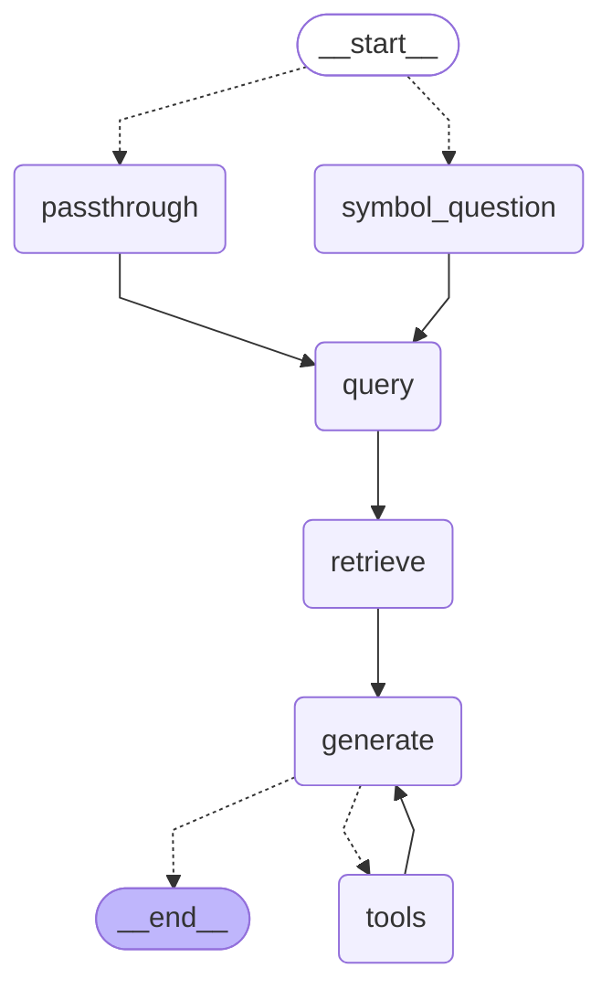

# LaTeX 기호 Parser

> **수식에서 모르는 기호는 검색이 안 된다.** `\sup`를 구글에 칠 수도 없고, 쳐도 "이 식에서 왜 여기 있는지"는 안 나온다. 그래서 **기호를 클릭하면 그 맥락에서의 의미를 답해주는 서비스**를 만들었다. 답은 내 수학노트에서 먼저 찾고, 없으면 위키피디아로 간다. 노트가 쌓일수록 빨라지고 개인화된다.

---

## 1. 서론

### 1-1. 프로젝트 주 흐름


㉠ 질문자는 하나의 항을 보여주는 파란 박스를 클릭하던가, 기호의 의미를 찾기 위해 빨간 박스를 클릭한다.

㉡ 박스를 클릭하면 해당하는 LaTeX(KaTeX가 될 수도 있다. 이하 KaTeX도 표현)가 추출된다 여기서 각 변수는 다음과 같다 `symbol`: 고른 박스에 해당하는 LaTeX 문자열 `context`: 고른 박스를 포함하는 파란 박스에 해당하는 LaTeX 문자열 `full_formula`: 고른 박스가 속한 수식 전체 `page_title`: 해당 페이지의 제목(정의/정리)

㉢ 박스를 클릭하면 박스의 대상을 물어보는 질문이 일정 형태에 맞춰 생성된다 `question`: 형태에 맞춰진 질문 `thread_id`: 사용자의 현재 스레드. 대화를 이어나갈 수 있다

㉣ 질문이 생성되면 자동으로 챗봇에게 질문하게 되고, 이후 추가 질문이 있으면 보통의 챗봇처럼 대화할 수 있다 `question`: 이후의 질문도 이 변수다

㉤ 위키피디아 문서 주소를 입력하면 그 문서의 블록 수식을 섹션별로 가져와 같은 방식으로 클릭할 수 있다. 이때 내 노트에 없는 내용이므로 RAG가 부족할 때 도구 호출이 발동하는 경로를 실제로 보게 된다

{아직 미구현} ㉥ 누를 수 있는 것 중 기호나 정의/정리 안의 단어라면 그것을 의미하는 문서의 페이지로 옮길 수 있다 이것이 곧 digital garden처럼 작동한다

㉦ 질문자가 원한다면 페이지가 옮겨도 기존 `thread_id`에서의 맥락을 이어받은채로 챗봇과의 대화를 이어나갈 수 있다. 당연히 기호 클릭 등에 의한 질문도 계속 이어나갈 수 있다

### 1-2. 과제 사용 개념

이번 과제는 **데이터를 불러와서 → LLM을 추가 내용으로 학습시키고 → 이를 토대로 답변을 생성하게 하는** 과정이었다. 이를 **LangGraph 구조로 연결하고 → 평가 체계를 통해 검증하며 → FastAPI로 연동하고 → Docker/AWS로 배포**하였다

|구분|수행한 내용|핵심 개념|
|---|---|---|
|RAG|LLM 연동, 학습 데이터 호출/청킹/임베딩/Chroma 인덱싱,<br>프롬프팅 후 알맞은 답변 생성의 흐름|외부 지식 연동 흐름|
|LangGraph|조건부 라우팅, 도구 호출 루프, 체크포인터|상태 기반 파이프라인|
|평가|DeepEval GEval/내장 지표, **지표 자체의 판별력 검증**,<br>라우팅은 judge 없이 `assert`로|측정 가능한 개선|
|FastAPI|질의응답 + 페이지 제공 + 위키 수집 엔드포인트, 정적 파일 서빙|HTTP 경계|
|파서|정규식으로 불가능한 중첩 구조를 깊이 카운터로 직접 구현|렉싱/파싱|
|배포|Docker 이미지, AWS EC2 + Elastic IP, 공개 접속|운영|

---

## 2. 과제 진행 흐름

```text
(RAG 데이터 저장하고 불러오는 기반)
env 파일 로딩
→ md 파일 로딩/청킹/임베딩/인덱싱
→ chroma_db에서 데이터 가져오는 retriever 정의

(수식을 클릭 가능하게 만드는 기반)
md 파일의 인용구에서 대표 수식 추출 / 위키 URL에서 섹션별 블록 수식 추출
→ 토크나이저가 수식을 조각으로 나누고 \htmlData 이름표를 심음
→ 프론트엔드가 KaTeX로 통째 렌더링, DOM의 data-token 속성을 클릭으로 읽음

(답변 생성 파이프라인 설계)
박스 클릭 판단
→ 박스 클릭 시/클릭 안 할 시의 질문 전달 및 dictionary화
→ retriever를 통해 chroma_db에서 답변에 필요한 정보 습득
→ 기호를 못 찾으면 위키 원문에서 그 기호가 든 문장을 추가 탐색
→ 불러온 정보에 따라 프롬프트 작동
→ llm 연동 후 답변 생성
→ 필요하다면 툴 호출을 반복하여 최종 답변 생성

(LangGraph로 파이프라인 작동)
State 클래스 정의
→ 들어온 State에 대해 node 함수들이 Graph에 따라 작동
→ 답변 생성에 문제가 있을 시 툴 함수 호출되도록 유도
→ WikipediaLoader 연결하여 정보 습득
→ 컴파일 후 체크포인터 생성

(평가)
기준선 측정 → 개선 적용 → 같은 조건으로 재측정
단, 지표를 믿기 전에 지표의 판별력부터 검증

(FastAPI 연동 및 배포)
엔드포인트 정의 → 정적 파일 서빙 → Docker 이미지 → AWS EC2
```

---

## 3. 프롬프트 목표 데이터

다음과 같이 세 가지 데이터를 사용하는 것을 목표로 한다. 대신 프롬프트를 읽는 데는 순서가 없다는 것을 염두에 두자

### 3-1. Wikipedia (tools.py)

```python
@tool
def wiki_search(query: str) -> str:
    """로컬 문서에 없는 수학 개념/기호를 영어 위키피디아에서 검색한다.
    로컬 검색 결과가 질문에 답하기에 부족할 때만 사용하라."""
    try:
        loader = WikipediaLoader(query=query, lang="en", load_max_docs=3)
        docs = loader.load()
        return "\n\n".join(doc.page_content for doc in docs)
    except Exception as e:
        return f"위키피디아 검색 실패: {e}. 검색 없이 아는 범위에서 답하거나, 실패했다고 사용자에게 알려라."
```

**사용 방법**:

- llm이 3-3의 문서로도 `generate`에서 대답을 만들지 못 한다면,
- `AIMessage`는 `'type': 'tool_call'`을 통해 tool 호출
- 이후 `wiki_search` 함수에서 `WikipediaLoader`를 통해 `ToolMessage` 생성 후 str로.

**사용 이유**:

- 가장 많은 수학 정의/정리에 대한 설명이 들어있음
- 3-3의 로컬 문서에서 부족한 부분을 무슨 경우가 있더라도 대답할 수 있음

**관측된 한계**:

- llm이 만드는 검색어 자체는 멀쩡했다(`"lambda Riemann integral"` 등). 문제는 **돌아오는 내용**이었다. 위키 문서는 기호 사전이 아니라서 "이 식에서 λ는 분할의 크기를 뜻한다" 같은 문장이 따로 있지 않다. → 근본 해법은 3-2의 기호 사전이고, 임시 대응으로 4-2-ㅅ의 기호 용례 추출을 넣었다.

### 3-2. 기호 다의성 판별 전용 md 파일 (미구현)

(재밌을 것 같은) **사용 방법**:

- 정의/정리랑 기호 설명을 다른 metadata로 넣고
- `vectorstore.as_retriever(..., search_kwargs={"k": RETRIEVER_K, "메타데이터": "종류"})` 같은 식으로 구분한다
- 그리고 prompt에 다른 { } 위치에 집어넣고, tools.py로 가는 조건을 생각해본다
- 기호 md 파일은 50개 정도 넣는다

**사용 이유**:

- 사실 어느 문서든 여러 기호에 대한 이야기는 많지 않음
- `question`과 `context`에 따라 기호의 의미는 무궁무진함. → 그것을 구분해 줄 필요가 있음
- 기호의 설명과 정의/정리의 설명을 같이 할 수 있다

**이 프로젝트에서 가장 큰 미완성 지점이다.** 평가에서 `symbol_explanantion` 점수가 0.5에 몰렸던 것도, `\eta` 같은 그리스 문자를 제대로 답하지 못하는 것도 결국 여기로 수렴한다.

### 3-3. 정의/정리 md 파일 (ingest.py)

```python
    md_paths = sorted(glob(MD_GLOB, recursive=True)) # 테스트용
    md_docs = []
    for p in md_paths:
        md_docs.extend(TextLoader(p, encoding="utf-8").load())

    docs = md_docs
```

**사용 방법**:

- config.py를 통해 문서 디렉토리를 설정하고 → TextLoader로 리스트에 추가한 후, → 청킹하고, 임베딩한 후, Chroma에 인덱싱

**사용 이유**:

- tools.py까지 안 가고 훨씬 빠르게 대답 생성 가능
- **내가 공부한 것을 집어넣은만큼 답변이 빨라지고 이해가 깊어지는 나만의 digital garden 생성 가능**

---

## 4. 파일 역할 설명

### 4-1. scripts/

#### ㄱ. ingest.py

md 파일을 RAG 데이터로 쓰기 위한 파일

**전체 흐름** → md 파일 로딩 → 청킹 → 임베딩 → 인덱싱 등 일반적인 RAG 데이터를 위한 조치

**특이사항**

- md 파일의 변경이 있을 경우 실행해줘야 하는 파일
- 이후 chroma_db/에 Vector 데이터베이스가 저장되도록 함.
- 주소는 src/config.py의 `MD_GLOB` 변수에 따라 설정됨
- chroma_db/의 파일은 .gitignore에 포함 → **배포 시 문제가 된다.** git clone으로는 따라가지 않으므로 scp로 별도 전송해야 함

**앞으로의 과제**

- 기호 다의성 판별 전용 md 파일 추가
- `metadata`로 정의/정리와 기호를 구별하는 항목 추가
- 컨테이너 시작 시 `chroma_db`가 비어있으면 자동 ingest하는 구조
- 현재 인덱싱시킬 수 있는 파일의 수가 너무 적음. batch 등을 이용해서 늘리는 것도 중요한 과제

### 4-2. src/

#### ㄱ. config.py

공용으로 쓰이는 변수를 정의하는 파일

**전체 흐름** → env 파일 로딩 → 임베딩 모델 연결 → 그 외 변수들 수정이 용이하도록 정의

#### ㄴ. retriever.py

Vector 데이터베이스에서 질문과 관련된 데이터를 불러오는 파일

**전체 흐름** → ingest.py와 동일한 임베딩 모델 호출 → chroma_db/에서 유사도 기반 데이터 불러오고 return

**앞으로의 과제**

- retriever를 두 개 만들어 정의/정리와 기호 데이터 선택용으로 사용
- 기호용 retriever는 유사도 기반 추천이 필요하지 않아 보임. 같은 LaTeX 기호 들어가면 추천 → 이 직관은 실제로 맞았다. 그리스 문자 하나의 임베딩에는 의미가 거의 없어 유사도 검색이 헛돈다. 4-2-ㅅ에서 문자열 매칭으로 구현한 이유다.

#### ㄷ. node.py

LangGraph 형태로 작동할 함수들을 정의하는 파일

**전체 흐름** → `route`로 박스 클릭 질문 판단. 박스 클릭 시 `state`의 `symbol`이 채워지므로 이를 통해 판단 → `symbol_question`에서 박스 클릭 시의 질문 생성, `passthrough`로 일반 질문 시 통과 → `query`에서 `"messages"`에 합쳐질 질문 dictionary를 return → `retrieve`에서 retriever 이용하여 문서 수집 후 `"documents"`랑 `"sources"` 정의 이때 **기호 클릭 + 위키 페이지 + 검색 결과에 그 기호가 없음** 세 조건이 모두 맞으면 위키 원문에서 그 기호가 든 문장을 추가로 붙인다 (4-2-ㅅ) → `generate`에서 프롬프트 설정, `llm`에 연동 후 `"messages"`로 추가 이 과정에서 `TOOLS` 호출 존재

**특이사항**

- 일반적으로 `route`, `symbol_question`, `passthrough`, `query`는 한 함수로 표현할 수 있으나, LangGraph 문법 연습 겸 이렇게 표현
- `"sources"`가 중복되는 현상이 있어 `list(dict.fromkeys(sources))` 사용
- **추가 근거는 라벨을 붙여서 합친다.** `[내 노트에서 검색된 내용]`과 `[문서 원문에서 찾은 해당 기호의 용례]`로 나누면 llm이 둘의 역할을 구분한다. 덮어쓰지 않는 이유는, 기호가 없다고 해서 그 문서가 주제상 무관한 것은 아니기 때문이다.

**앞으로의 과제**

- 프롬프트에 세 가지 종류의 문서를 유동적으로 볼 수 있도록 설계
- `documents`를 단일 문자열이 아닌 리스트로 유지 (아래 평가 섹션의 `cp`/`cr` 문제)

#### ㄹ. graph.py

node.py에 적용할 함수들을 그래프로 연결



**전체 흐름** → `State` 클래스 정의 `messages`: 지금까지의 대화 내용 저장 `documents`: RAG에서 가져온 내용 저장 `sources`: RAG에서 가져온 내용들의 출처 저장 `full_formula`: 클릭한 기호가 속한 수식 전체 `tool_call`: 도구 호출 여부. 평가에서 라우팅 검증에 쓰인다 나머지 변수의 설명은 기존과 같음 → node.py 함수에 대응하는 노드 생성 이 과정에서 tools.py의 `TOOLS`를 통해 `ToolNode`도 생성 → 설계에 맞게 edge 연결 조건부 edge를 사용하고, `tool`을 위한 루프에 가까운 edge 구조도 생성 `tools_condition`을 보고 다시 루프를 돌거나 `END`로 가는 구조 → 컴파일 후 `InMemorySaver`로 체크포인터 생성

**특이사항**

- `messages: Annotated[list, add_messages]` 메시지가 계속 쌓일 수 있도록 `Annotated`와 `add_messages` 기능 사용
- `State`는 `TypedDict`라 **타입 힌트일 뿐 기본값을 만들어주지 않는다.** 선언에 필드를 추가해도 실제 딕셔너리에 키가 생기지 않으므로, State를 만드는 모든 곳(`main.py`, `run_eval.py`)을 같이 고쳐야 한다.

**앞으로의 과제**

- `InMemorySaver`대신 `SqliteSaver`를 통해 대화를 영속화 및 관리
- State 생성을 공용 팩토리 함수로 분리 (아래 에러 노트 참조)

#### ㅁ. tools.py

`llm`이 사용할 tool들을 정의하는 파일. 당장은 Wikipedia 검색 기능 중심

**전체 흐름** → 툴 함수를 호출하는 조건 프롬프트 정의 → WikipediaLoader를 통해 호출 후 결과 return → 예상치 못한 오류 발생을 대비해 Exception 상황 설정

**특이사항**

- `lang="en"`로 설정하여 개인적으로 수학에 걸맞다고 생각하는 대화는 한국어, 수학 개념은 영어인 상황이 되도록 꾀함
- **툴 경로는 구조적으로 느리다.** `generate`(툴 호출 판단) → 네트워크 → `generate`(결과로 답 생성)이라 **llm 호출이 두 번**이고, 두 번째는 툴 결과를 기다려야 하므로 병렬화도 안 된다. 따라서 툴 자체를 빠르게 하는 것보다 **부르는 횟수를 줄이는 쪽**이 효과가 크다.

**앞으로의 과제**

- 온디맨드 위키피디아 인제스트: 받아온 내용을 Chroma에 저장해 다음 질문부터는 로컬 검색으로 끝내기 (llm 2회 → 1회)
- `load_max_docs` 축소와 `doc_content_chars_max` 제한
- Wikipedia 결과인데도 `"sources"`가 로컬 문서로 존재하는 상황 발견. 위키 문서 URL을 `"sources"`에 담기

#### ㅂ. schemas.py

main.py에 쓸 `BaseModel`을 통한 클래스 생성 `Pydantic`을 사용하므로 타입 표기를 전부 해야 한다

**특이사항**

- FastAPI는 **파라미터의 타입을 보고 값의 출처를 결정한다.** Pydantic 모델이면 요청 본문, 경로에 `{}`로 있는 단순 타입이면 경로, 경로에 없는 단순 타입이면 쿼리 파라미터. 그래서 `POST /wiki`에 URL을 본문으로 받으려면 `WikiRequest` 모델이 필요하다.

#### ㅅ. tokenizer.py (신규)

**LaTeX 수식을 클릭 가능한 토큰으로 가공하는 파서.** 직접 구현했다.

**왜 직접 만들었나**

중첩된 중괄호는 **정규식으로 짝을 맞출 수 없다.** 파이썬 `re`의 한계가 아니라 정규식이라는 도구 자체의 한계다 — 정규 언어에는 "지금 몇 겹 안에 있는지" 세는 기억이 없다.

```
최단 매칭 \{.*?\}  → {\frac{a}{b}}  에서  {\frac{a}{b}  로 끊김
최장 매칭 \{.*\}   → {a} + {b}      을 하나로 삼킴
```

그래서 카운터(=기억)를 가진 파서가 필요했다.

**핵심 설계: `\htmlData`로 이름표를 심는다**

토큰별로 따로 렌더링해서 이어붙이면 `\frac`의 분자만 떼는 순간 분수 구조가 깨진다. 대신 **원본에 이름표를 심고 수식 전체를 한 번에 렌더링**한다.

```latex
\htmlData{term=0}{\htmlData{token=0}{\overline{\int_{I}}}\htmlData{token=1}{f}}
= \htmlData{term=1}{...}
```

KaTeX가 이를 렌더링하면 해당 DOM 조각에 `data-token="0"` 속성이 남는다. 프론트엔드는 클릭 지점에서 `closest('[data-token]')`로 **번호만 읽어** 테이블을 조회한다.

- 레이아웃이 온전히 유지된다
- **프론트엔드가 LaTeX를 전혀 파싱하지 않는다**
- 매핑 문제가 "역추적"에서 "이름표 읽기"로 바뀐다
- 중첩된 `\htmlData`도 KaTeX가 처리하므로, 안쪽 토큰을 만들면 `closest`가 자연히 가장 안쪽을 먼저 잡는다
- 렌더링 옵션에 `trust: true`가 필요하다 (HTML 삽입 명령은 기본적으로 잠겨 있음)

**파이프라인 (일직선)**

|단계|함수|하는 일|
|---|---|---|
|1|`lexer`|문자열 → 조각 리스트. `\명령어`(알파벳 연속), `{...}`(깊이 카운터로 균형 맞춰 통째), 나머지 한 글자씩|
|2|`attach_args`|`ARITY` 딕셔너리를 보고 명령어에 인자 병합. `\frac` + `{a}` + `{b}` → `\frac{a}{b}`|
|3|`merge_scripts`|`_`, `^`를 만나면 결과 리스트의 **마지막 항목**에 이어붙임|
|4|`split_terms`|괄호 깊이를 추적하며 깊이 0에서만 `SPLITTERS`로 항 분리. `\begin`/`\end`도 경계. 결과는 `[('term', [...]), ('split', '='), ...]`|
|5|`build`|`\htmlData` 삽입 + `tokens`/`terms` 테이블 생성|
|6|`tokenize_sections`|섹션 뭉치를 순회하며 `build`를 반복 호출, 번호를 이어감|

**설계 판단들**

- **`attach_args`가 `merge_scripts`보다 먼저인 이유**: `\frac{a}{b}^2`에서 순서가 반대면 `{b}`가 지수를 먼저 먹어 `\frac`이 `{a}`와 `{b}^{2}`를 인자로 받는다. 의미가 바뀐다.
- **`build`가 시작 번호를 받는 이유**: 수식마다 호출되므로 매번 0부터 매기면 `tokens["0"]`이 여러 수식에 존재해 테이블에서 덮어써진다. 테이블을 **페이지 단위로 하나만** 두기 때문에 번호가 겹치면 안 된다.
- **테이블을 페이지 단위로 둔 이유**: 프론트 클릭 핸들러가 번호만 알면 되도록. 수식별로 나누면 "어느 수식에서 눌렸는지"를 먼저 알아야 한다.
- **감싸지 않는 조각**(`is_bare`): `NO_TOKEN`(괄호·쉼표), `STRUCTURAL`(`&`, `\\`), 숫자, `\begin`/`\end`로 시작하는 것, 직전이 `\left`/`\right`인 것. **감싸지 않는다는 것은 클릭 대상에서 뺀다는 뜻이지 수식에서 지운다는 뜻이 아니다.** `annotated` 문자열에는 반드시 남아야 한다.
- **`\begin{align}`은 지원된다.** 규칙은 하나 — wrapper가 `&`나 `\\`를 삼키면 안 된다. 셀 안쪽만 감싸면 정렬이 유지된다. `&`와 `\\`를 `SPLITTERS`에, `\begin{...}`/`\end{...}`를 경계로 처리하면 구조적으로 그렇게 된다.
- **왜 LangGraph를 쓰지 않았나**: 이 파이프라인은 분기도 루프도 상태 영속화도 없는 일직선이다. LangGraph는 **단계 사이**의 복잡성을 해결하는 도구고, 여기서 복잡한 것은 **단계 안쪽**이다. 순수 함수로 두어 단계별 테스트가 쉬운 이점도 크다.

**`load_formulas()`** — md의 `>` 인용구 블록에서 `$$` 우선, 없으면 가장 긴 `$...$`를 뽑아 `RAW_FORMULAS`를 만든다. 인용구 표시는 이미 노트에서 정리 진술에 쓰던 관습이라 새 규칙을 도입할 필요가 없었다.

**앞으로의 과제**

- 중첩 토큰(그룹 안쪽 재귀) — `\frac{a}{b}`의 분자, `_{i=1}`의 내부가 따로 클릭되게. 텍스트류 명령어(`\mathrm`, `\text`)는 재귀 제외, 깊이 3~4 제한
- 함수 적용 묶기 — `f`, `E`, `L`, `\sin`은 `f( )` 형태여야 의미가 생긴다
- 절댓값 `|...|` 페어링 — 여는 것과 닫는 것이 같은 글자라 깊이로 셀 수 없다
- 의미 없는 토큰 거르기 — `x_0 \leq t_1 \leq x_1` 같은 나열에서 `x_1`을 토큰화하는 것

#### ㅇ. wiki.py (신규)

위키피디아 문서 주소에서 섹션별 블록 수식을 추출하는 파일

**전체 흐름** → `urlparse`로 위키피디아 도메인인지 검증, `unquote`로 퍼센트 인코딩 해제 → MediaWiki API(`action=parse&prop=wikitext&formatversion=2`)로 wikitext 획득 → `==` 헤딩 위치로 구간을 나누고, 각 구간의 블록 수식을 수집 → `{"sections": [...], "wikitext": ...}` 반환

**특이사항**

- **한국어 문서 주소가 퍼센트 인코딩으로 온다.** `unquote`를 거치지 않고 `params`에 넘기면 `requests`가 한 번 더 인코딩해 문서를 못 찾는다.
- **ko → en 변환은 불필요하다.** 추출 대상이 `<math>` 안의 LaTeX인데 **LaTeX는 언어에 무관하다.** 영어 용어를 원하는 것은 llm의 답변이고, 그건 프롬프트에서 정하면 된다. 게다가 도메인만 바꾸면 제목이 번역되지 않아 404가 난다.
- **블록 수식 판정이 두 가지다.** `:<math>...</math>`(콜론 들여쓰기)와 `<math display="block">`(속성 방식). 모든 `<math>`를 찾은 뒤 속성에 `display="block"`이 있거나 앞 글자가 `:`이면 블록으로 본다.
- **헤딩 정규식은 줄 단위로 못 박아야 한다.** `re.DOTALL`을 쓰면 `==`가 짝 없이 나타났을 때 몇 줄이고 건너뛴다. `^(={2,6})\s*(.*?)\s*\1\s*$`에 `MULTILINE`으로 여는/닫는 등호 개수를 맞춘다.
- **User-Agent 헤더가 필수다.** 위키미디어 정책상 기본값으로 요청하면 차단될 수 있다.

**예외 설계**

`wiki.py`는 웹 프레임워크를 모른 채로 남긴다. 자기 도메인 예외를 던지고, HTTP 상태 코드 변환은 `main.py`가 한 곳에서 담당한다.

```python
class WikiError(Exception): ...
class NotWikipediaURL(WikiError): ...
class WikiPageNotFound(WikiError): ...
class NoFormulaFound(WikiError): ...
class WikiFetchFailed(WikiError): ...
```

- 공통 부모를 두면 `except WikiError` 하나로 다 잡히고, 예외를 추가해도 잡는 쪽을 안 고친다
- 메시지를 `super().__init__`에 넘겨 `str(exc)`가 사람이 읽을 문장이 되게 한다
- 데이터를 속성으로 남겨 `exc.title` 같은 접근이 가능하게 한다
- **`raise ... from err`** 로 원인을 붙인다. 없으면 타임아웃이었는지 DNS였는지를 잃는다

**앞으로의 과제**

- 위키 본문 문단 수집 — `\eta > 0`처럼 **수식이 아니라 문장에 정의가 있는** 경우 대응
- 수식에 딸려오는 번호 `(1)` 제거
- ar5iv(`https://ar5iv.labs.arxiv.org/html/<id>`)로 arXiv 논문 확장. 저자 정의 매크로가 이미 전개된 HTML이라 tex 소스보다 다루기 쉽다

#### ㅈ. 기호 용례 추출 (`find_symbol_lines`)

**문제**: `\eta`의 뜻은 수식 안이 아니라 **문장 안**에 있다. ("where η > 0 is a constant") 그런데 retriever는 유사도 기반이고, **그리스 문자 하나의 임베딩에는 의미가 거의 없다.**

**해결**: 저장해둔 wikitext에서 해당 기호가 든 문장을 **문자열로** 찾는다. 정의처럼 보이는 문장(`where`, `let`, `denote`, `defined`, `라 하` 등)을 앞으로 정렬하고, 기호 위치를 중심으로 앞뒤를 잘라 글자 수 예산 안에서 반환한다.

**발동 조건이 세 겹이라 대부분의 경우 아무 일도 일어나지 않는다.**

```
기호 클릭이고 + 위키 페이지이고 + 검색된 문서에 그 기호가 없을 때
```

마지막 조건이 llm 호출 없이 문자열 검사만으로 "retriever가 실패했는지"를 판정한다는 점이 핵심이다. 덕분에 `x`나 `f`처럼 흔한 기호는 대체로 발동하지 않는다.

### 4-3. static/

#### ㄱ. index.html (신규)

단일 파일 프론트엔드. CSS·HTML·JS가 한 파일에 있다.

**함수 다섯 개가 전부다**

|함수|하는 일|
|---|---|
|`loadPageList`|`GET /pages` → 드롭다운 채우기|
|`loadPage`|`GET /page/{title}` → 섹션별로 `katex.render`. 여기서 `data-token` 속성이 생긴다|
|클릭 핸들러|`closest('[data-token]')`로 번호 읽기 → `tokens` 테이블 조회 → `symbol`, `context`, `full_formula` 확보|
|`sendQuery`|`POST /query` → 말풍선 추가|
|`addWikiPage`|`POST /wiki` → 목록 갱신 → 새 페이지 선택|

**특이사항**

- **KaTeX를 CDN이 아니라 로컬에 둔다.** CDN 폰트가 깨져 오면 큰 괄호·적분기호가 두부(□)로 표시된다. `static/katex/`에 배포판을 두면 네트워크와 무관해진다.
- **texvc 매크로는 `macros` 옵션으로 해결한다.** `\Q`, `\R`, `\sub`, `\isin` 등은 위키피디아 전용 확장이라 KaTeX가 모른다. `{"\\Q": "\\mathbb{Q}", ...}`를 등록하면 `\htmlData`와 함께 써도 문제없다.
- **`z-index`가 필요하다.** KaTeX는 `align` 같은 여러 줄 수식을 음수 위치로 겹쳐 쌓아서, 윗줄의 보이지 않는 영역이 아랫줄의 클릭을 가로챈다.
- **`ChatPromptTemplate`에 LaTeX 예시를 넣을 때는 중괄호를 `{{ }}`로 이스케이프한다.** `\mathbb{R}`의 `{R}`이 템플릿 변수로 인식되어 `KeyError`가 난다.

### 4-4. eval/ (신규)

평가 체계. 자세한 내용은 아래 5장.

|파일|역할|
|---|---|
|`metrics/judge_model.py`|judge용 Anthropic 모델 정의|
|`metrics/geval_metric.py`|GEval 지표 3종 (`ar`, `se`, `ne`)|
|`metrics/rest_metric.py`|DeepEval 내장 지표 3종 (`ff`, `cp`, `cr`)|
|`run_eval.py`|데이터셋 31개를 파이프라인에 태우고 채점|
|`calibration.py`|**지표 자체의 판별력을 검증**|
|`datasets/`|일반 질문 / 기호 질문|
|`results/`|실행별 결과 (`01_baseline.txt`, `02_prompt_ladder.txt` ...)|

### 4-5. test/

#### ㄱ. test.py

파이프라인의 각 단계가 잘 작동하는지 확인하는 파일

**전체 흐름** → 특정 키워드에 대해서 retriever의 output을 본다 → 같은 키워드에서 node.py의 함수에 대해서도 retrieve가 잘 되는지 본다 → md 파일에 '있'는 주제에 대해 답변을 생성할 때 `tool_calls`를 관찰한다 → md 파일에 '없'는 주제에 대해 답변을 생성할 때 `tool_calls`를 관찰한다 → graph가 잘 생성되었는지 `.draw_mermaid()`를 통해 확인한다 → 전체 파이프라인이 잘 돌아가는지 임시 `State`를 집어넣는다

**특이사항**

- 중간 과정에서의 output이 무엇인지 잘 생각해야 한다 대표적으로 `generate` 함수는 graph.py에서 부르기 전까진 리스트 딕셔너리의 결과물일 뿐이다
- 토크나이저는 순수 함수라 **단계별로 `print`를 찍으며 하나씩 통과시킬 수 있었다.** 그래프 구조였으면 이 방식이 훨씬 번거로웠을 것이다.
- md 파일이 바뀔 때마다 ingest.py를 실행시켜야 한다

### 4-6. 상위 폴더/

#### ㄱ. main.py

FastAPI를 이용해 받아들이고 내보낼 데이터를 결정하는 파일

|엔드포인트|역할|
|---|---|
|`POST /query`|기존 질의응답. LangGraph invoke|
|`GET /page/{title}`|토큰화된 페이지 반환 `{sections, tokens, terms}`|
|`GET /pages`|제목 목록 (드롭다운용)|
|`POST /wiki`|URL 받아 `WIKI_PAGES[title] = {url, sections, wikitext}` 저장 후 제목 반환|

**전체 흐름** → 앱 초기화 시점에 LangGraph 생성 → `QueryRequest`의 변수들을 State에 이식 → `thread_id`를 집어넣는 `config` 변수 포함 → 이후 LangGraph에 invoke한 후 나온 결과를 `QueryResponse` 형태로 return

**특이사항**

- `QueryResponse`의 `answer`는 `"messages"`의 마지막 부분만
- 이때 AIMessage의 `.content`는 메시지 형태가 복잡하므로 `.text` 사용
- **`app.mount("/", StaticFiles(...))`는 반드시 라우트 정의 아래에.** 위에 두면 mount가 모든 경로를 삼켜 API가 404가 된다.
- **예외 핸들러 하나로 도메인 예외를 HTTP로 번역한다.**

```python
STATUS = {
    NotWikipediaURL: 400, WikiPageNotFound: 404,
    NoFormulaFound: 404, WikiFetchFailed: 502,
}

@app.exception_handler(WikiError)
def handle_wiki_error(request, exc: WikiError):
    return JSONResponse(status_code=STATUS.get(type(exc), 500),
                        content={"detail": str(exc)})
```

엔드포인트에는 try/except가 없다. 예외가 밖으로 빠져나가면 FastAPI가 타입(과 그 부모)을 보고 핸들러를 찾는다. **부모 클래스를 둔 이유가 여기 있다.**

**앞으로의 과제**

- 대화 세션을 조회 관리하는 기능 추가. 로그인 여부는 검토
- 캐싱을 하여 기호 클릭한 질문에 대한 대답은 동일한 대답을 하도록 함
- `main.py`와 `run_eval.py`가 State를 각각 만드는 중복 제거

---

## 5. 평가 체계

**이 프로젝트에서 가장 시간을 많이 쓴 부분이고, 가장 배운 것이 많은 부분이다.**

### 5-1. 지표 구성

|지표|종류|`expected_output`|재는 것|
|---|---|---|---|
|`ar_metric`|GEval|필요|정답지의 핵심 내용 재현|
|`se_metric`|GEval|불필요|기호 설명이 식·페이지와 연관됐는가|
|`ne_metric`|GEval|불필요|노트의 구어체를 정돈했는가|
|`ff_metric`|Faithfulness|불필요|답변이 컨텍스트에 근거하는가|
|`cp_metric`|ContextualPrecision|**필요**|관련 청크가 상위에 랭크됐는가|
|`cr_metric`|ContextualRelevancy|불필요|가져온 청크가 질문과 관련 있는가|

**참조/비참조의 정확한 의미**: "비참조"는 정답지가 **필요 없다**는 뜻이지 정답지가 있으면 **못 쓴다**는 뜻이 아니다. 지표에 필요한 파라미터가 없으면 에러가 나고, 남는 것은 무시된다. 따라서 배분 기준은 두 층이다.

- **기술**: 정답지가 필요한 지표(`ar`, `cp`)는 `answer`가 있는 케이스에만
- **의미**: 그 그룹에서 **올바른 행동이 낮은 점수를 받는** 지표는 제외. 표준 수학 기호 질문은 문서 없이 답하는 것이 정답인데 faithfulness는 문서 근거를 요구하므로 오탐이 된다

**GEval만 `evaluation_params`가 필요하다.** 내장 지표는 자기가 쓸 파라미터가 코드에 박혀 있지만, GEval은 범용 껍데기라 **뭘 보여줄지 지정해야 한다.** 여기서 규칙 하나가 나온다 — **criteria가 언급하는 것만 `evaluation_params`에 넣는다.** 둘이 어긋나면 judge가 없는 자료를 상상하거나, 시키지 않은 것을 평가한다.

### 5-2. judge 보정 방법론

**지표를 만들었다고 그 숫자를 믿을 수는 없다.**

정답지를 **하나로 고정**하고, 좋은/중간/나쁜 답변 3종을 **손으로 작성**해 점수를 잰다.

```
판별력 = 정상 점수 − 망함 점수
```

절대 점수는 중요하지 않다. 정상 4.5 / 망함 4.3이면 그 judge는 아무 정보도 주지 않고, 정상 3.8 / 망함 1.2면 절대값이 낮아도 쓸모 있다. **판별력 0.7 이상이면 사용 가능**으로 보았다.

**방법론상 지켜야 할 것**: 후보를 고쳐 점수를 맞추면 **아무것도 측정하지 않은 것**이 된다. judge가 동의할 때까지 문제를 바꾸는 셈이기 때문이다. 순서는 이렇다.

1. 루브릭을 보고 각 칸의 **명확한 예시**로 후보를 만든다
2. 후보를 고정한다
3. 점수가 안 맞으면 **criteria를 고친다**

후보 수정은 "이 후보가 어느 칸인지 애매했다"가 판명될 때만 정당하다.

**결과**: `ar` 0.70~0.90, `ne` 0.60~1.00, `se` 0.70~1.00.

### 5-3. `ne_metric` 요인 실험

`retrieval_context`(원문)를 judge에게 주면 평가가 정교해질 것으로 예상하고 다섯 설정을 실측했다.

|`retrieval_context`|criteria|판별력|중간 등급|
|---|---|---|---|
|없음|원본(비교형)|0.70 / 0.80|0.70 / 0.60|
|있음|비교형|0.50 / 0.70|**0.90 / 0.80**|
|있음|출력 전용|0.40 / 0.60|0.60 / 0.60|
|없음|출력 전용|0.40 / 0.60|0.40 / 0.60|
|**없음 + 상황 서술형**|—|**0.60 / 1.00**|**0.50 / 0.50**|

**예상과 반대였다.**

**① 자료를 주면 judge가 다른 것을 채점하기 시작한다.** 원문을 받은 judge는 출력 품질 대신 **원문 대비 개선폭**을 쟀다. 원문이 심한 구어체일수록 조금만 고쳐도 개선폭이 커 보여, 여전히 구어체가 남은 중간 등급 답변에 0.90을 주었다. 망한 답변에도 "시도했으나 실패"라며 부분점수를 줬다.

**② 자료를 주면 금지한 항목까지 평가한다.** criteria에 "답변의 정확성·충실성을 평가하지 마세요"라고 명시했는데도, 원문이 눈앞에 있으니 **내용 누락**을 감점 사유로 들었다. **지시로 막는 것보다 자료를 아예 주지 않는 편이 확실하다.**

**③ criteria를 추상적으로 다듬으면 판별력이 더 떨어진다.** "원문 문서의 구어체를 그대로 복사하지 않고"를 "답변 내용이 비격식체를 구사하지 않고"로 바꾸자 양쪽 조건에서 똑같이 0.2씩 떨어졌다. 찾을 대상이 구체적이어야 judge의 눈이 밝아진다.

**④ 최종안은 자료 없이 상황만 서술하는 것이었다.** "이 답변은 구어체로 작성된 개인 학습 노트를 참조해 생성되었습니다"처럼 **자료는 주지 않되 맥락은 구체적으로** 알려주는 방식. 판별력뿐 아니라 **중간 등급을 두 번 다 정확히 0.50으로 맞혔다** — 다른 어떤 설정도 못 한 일이다. 양 끝을 가르는 것과 **루브릭 단계를 맞히는 것**은 다른 능력이다.

### 5-4. 라우팅 검증은 judge 없이

**"툴을 불렀는가"는 텍스트 품질이 아니라 행동이다.** llm에 물을 이유가 없다.

데이터셋 항목에 `expect_tool: true/false`를 두고 `result["tool_call"]`과 대조한다. **llm 호출 0회, 즉시, 결정론적.** 흔들릴 여지가 없다.

### 5-5. 데이터셋 (31개)

파이프라인의 **각 경로를 밟게** 갈래를 나눴다. 개수보다 커버리지가 중요하다.

|갈래|개수|검증하려는 것|
|---|---|---|
|노트에 있는 주제 · 일반 · 정답지 있음|4|로컬 RAG + 재현도|
|노트에 있는 주제 · 일반 · 정답지 없음|4|로컬 RAG + 근거성|
|노트에 없는 주제 · 일반|4|툴 발동|
|노트에 있는 주제 · 기호 · 정답지 있음|4|기호 설명 + 재현도|
|노트에 있는 주제 · 기호 · 정답지 없음|4|기호 설명|
|노트에 없는 주제 · 기호|4|툴 발동 + 기호 설명|
|표준 수학 기호|5|**툴 없이** 바로 답하는가|

실패했던 케이스(`\lambda`, `\eta`, `\infty` 등)를 데이터셋에 포함시켜 **회귀 테스트**로 삼았다.

### 5-6. 측정 결과

||01_baseline|02_prompt_ladder|
|---|---|---|
|라우팅 OK|23/31|22/31|
|— **불필요한 호출**|5|**0**|
|— 필요한데 안 부름|3|9|
|GEval 평균|0.73 (n=48)|**0.85** (n=58)|
|Faithfulness|0.94|0.97|
|지연 p50|4637ms|재측정 필요|

**개선 내용**: 프롬프트 계층적 폴백(문서 근거 → 표준 기호는 바로 → 문서 특유 표기만 툴), 거절 조건("도구를 실제로 호출한 뒤에도 못 찾은 경우에만"), 기호 답변 형식 3요소(기호 자체 / 식에서의 역할 / 정리에서의 필요), `full_formula` 전달, 기호 용례 추출.

**해석**: 불필요한 툴 호출이 완전히 사라지고 답변 품질 평균이 0.12 올랐다. 다만 **필요한 호출까지 함께 사라져** 과소 호출이 3건에서 9건으로 늘었다. 계층적 폴백의 상단(호출해야 할 조건)을 다시 세우는 것이 다음 과제다.

**답변 형식 3요소는 `se_metric`의 루브릭 1.0 정의를 그대로 프롬프트로 옮긴 것이다.** 채점 기준을 답변 지시로 바꾸는 접근은 지표를 먼저 만들었기 때문에 가능했다.

---

## 6. 배포

Docker 이미지 → AWS EC2 + Elastic IP. **공개 URL로 접속 가능.**

**서버에서 빌드한다.** 로컬 맥은 arm64, EC2는 x86_64라 이미지를 그대로 옮기면 실행이 안 되거나 느려진다. 이미지는 빌드한 컴퓨터에만 생기므로, 소스를 보내고 서버가 자기 CPU에 맞게 빌드하게 한다. (정석은 레지스트리(ECR)에 push → pull이지만 설정 비용이 있어 다음 단계로 둔다.)

**`.gitignore`와 `.dockerignore`는 목적이 다르다.** `md/`와 `chroma_db/`는 git에 올리지 않지만 이미지에는 들어가야 한다. `git pull`로 따라가지 않으므로 `scp -r md chroma_db ...`로 별도 전송한다.

**Dockerfile 레이어 순서**: 의존성 설치를 소스 복사보다 **먼저** 둔다. 소스만 바뀌면 앞 단계는 캐시를 재사용해 재빌드가 몇 초로 끝난다.

```dockerfile
COPY pyproject.toml uv.lock ./
RUN uv sync --frozen --no-dev     # 무거운 작업
COPY . .                          # 가벼운 작업
```

**체크리스트**

- `uvicorn --host 0.0.0.0` (`127.0.0.1`이면 컨테이너 밖에서 접속 불가)
- 보안 그룹 인바운드 개방 (컨테이너 바인딩과 AWS 방화벽은 별개)
- `docker compose up -d` (SSH를 끊어도 유지), `restart: unless-stopped`
- 워커 1개 (`InMemorySaver`라 워커가 여럿이면 대화가 끊김)
- 검증은 **다른 기기에서.** 폰으로 LTE 접속해 열리면 확정

---

## 7. 에러 노트

### ㄱ. 같은 조건인데 하나만 안 걸린다 — 위치 의존 버그

`split_terms`에서 `\end{align}`은 경계로 잡히는데 `\begin{align}`은 안 잡혔다. 조건은 동일했으므로 **다른 것은 위치뿐**이었다 — `\begin`은 항상 index 0이다.

원인은 `if j > 0:`이 split 처리 **전체**를 감싸고 있었던 것. "맨 앞에서 잘리면 빈 항이 생기니 막자"는 의도였는데, 그 바람에 맨 앞의 구분기호는 경계로 인정되지 않고 뒤 항에 흡수됐다. `j > 0`이 **항 추가만** 막게 하고 split 자체는 항상 하도록 들여쓰기를 한 칸 옮겨 해결.

**교훈**: 같은 조건인데 하나만 다르게 동작하면 조건이 아니라 **상황**을 의심한다.

### ㄴ. 페이지를 열 때마다 토큰이 한 겹씩 쌓였다 — 가변 객체 공유

`\htmlData{token=0}{\htmlData}` 같은 출력이 나왔고, 구조를 보니 같은 토큰화가 **4겹으로 중첩**되어 있었으며 안쪽으로 갈수록 번호가 0부터 다시 시작했다.

원인은 `tokenize_sections`가 입력으로 받은 리스트를 **직접 수정**한 것.

```python
sec["formulas"][i] = r["annotated"]   # 저장소의 원본이 오염된다
```

파이썬에서 리스트·딕셔너리를 함수에 넘기면 **복사본이 아니라 같은 객체**가 간다. 그래서 저장소의 원본 수식이 토큰화된 문자열로 덮어써졌고, 다음에 그 페이지를 열면 이미 감싸진 것을 또 감쌌다. 페이지를 네 번 열어 네 겹이었다.

새 리스트와 새 딕셔너리를 만들어 담는 것으로 해결.

### ㄷ. traceback에 내 코드가 없어 보였다

`AttributeError: 'ParseResult' object has no attribute 'decode'`. `ParseResult`도 `decode`도 내 코드에 없는 이름이라 남의 문제처럼 보였다.

터진 곳은 라이브러리 안이지만, **원인은 내 파일이 마지막으로 등장하는 줄**에 있었다 — 이미 파싱된 결과를 다시 `urlparse`에 넘기고 있었다.

**교훈**: traceback은 아래에서 위로 훑으며 **내 파일이 처음 나오는 줄**을 찾는다. 그 아래는 남의 코드가 내 실수를 받아 넘어진 흔적이다.

### ㄹ. 화면이 이상한데 터미널이 조용하다

**터미널은 백엔드, 브라우저 콘솔은 프론트엔드.** KaTeX 렌더 실패나 자바스크립트 예외는 터미널에 아무것도 남기지 않는다.

특히 `sendQuery()`가 "생각 중…" 말풍선을 **요청 전에** 추가하므로, 그것이 안 보이면 **요청이 나가지도 않은 것**이다. 즉 프론트엔드에서 예외가 난 것이고 백엔드를 뒤질 이유가 없다. 증상이 어디까지 진행됐는지가 곧 범위를 좁혀준다.

### ㅁ. 지표가 항상 1.0이었다

`ContextualPrecision`이 모든 케이스에서 1.0이었다. 원인은 `retrieval_context`에 청크를 **단일 문자열 하나**로 넘긴 것. Precision은 "관련 청크가 관련 없는 청크보다 위에 랭크됐는가"를 재는데, 청크가 하나면 순위를 매길 대상이 없어 관련 있으면 무조건 1.0이다.

**검증하지 않았으면 계속 1.0을 보며 "검색 성능 완벽"이라 착각했을 지점이다.**

### ㅂ. DeepEval 실행이 세 가지 다른 이유로 죽었다

1. **judge 응답 truncation** — `max_tokens` 부족으로 JSON이 잘림
2. **LaTeX 백슬래시** — judge가 이유에 `\frac`을 그대로 써서 JSON 파싱 실패. `max_tokens`를 올려도 계속 났다. criteria에 "이유에 LaTeX 명령어를 쓰지 말라"를 추가
3. **`APIConnectionError`** — `evaluate()`가 테스트 케이스를 병렬로 돌려 수십 개 요청이 한꺼번에 나가면서 연결이 끊김

**해결: 배치를 버리고 `metric.measure(tc)`를 케이스마다 순차 호출.** 느리지만 실패해도 그 점수 하나만 잃는다. `evaluate()`는 그룹 전체가 날아가 두 번의 실행을 통째로 잃었다.

### ㅅ. 결과 순서가 입력 순서와 달랐다

`evaluate()`가 돌려주는 `test_results`가 병렬 실행 완료 순이라 `CANDIDATES[idx]`와 짝이 어긋났다. 판별력이 0.20, −0.80으로 나와 judge가 고장난 줄 알았으나, `reason`으로 역추적해 제자리에 놓으니 **둘 다 0.80**이었다.

**judge는 멀쩡했고 채점표가 어긋난 것이었다.**

### ㅇ. `main.py`와 `run_eval.py`가 State를 각각 만든다

`full_formula`를 추가했을 때 `run_eval.py`만 터졌다. `State`는 `TypedDict`라 선언에 추가해도 딕셔너리에 키가 생기지 않는다.

같은 이유로 LangFeather를 `main.py`에 붙였더니 평가 실행은 추적되지 않았다. **`run_eval.py`는 `main.py`를 거치지 않고 `build_graph()`를 직접 부른다.**

**원칙**: `main.py`는 HTTP 껍데기고 파이프라인은 전부 그래프 안에. State 생성도 공용 팩토리 함수로 빼야 한다. (미완)

---

## 8. 앞으로의 체크리스트

**완료**

- [x] 에러 노트 적기
- [x] test.py 만들기
- [x] try/except 오류 처리
- [x] README 작성
- [x] LaTeX 토크나이저 (렉서 → 인자 병합 → 첨자 병합 → 항 분리 → 재조립)
- [x] `\htmlData` 기반 클릭 매핑
- [x] 단일 파일 프론트엔드 (드롭다운, 위키 URL 입력, KaTeX 로컬 호스팅)
- [x] md 인용구에서 대표 수식 자동 추출
- [x] 위키피디아 URL → 섹션별 블록 수식 추출
- [x] 도메인 예외 계층 + FastAPI 예외 핸들러
- [x] Docker + AWS EC2 배포, 공개 URL 접속
- [x] eval.py 만들기
- [x] **평가지표의 판별력 검증** (`ar`, `ne`, `se`)
- [x] 라우팅 검증을 judge 없이 `assert`로
- [x] 기준선 측정 → 개선 → 재측정
- [x] 프롬프트 계층적 폴백 (부분 — 상단 재설계 필요)
- [x] 기호 용례 추출 (wikitext 문자열 검색)

**다음**

- [ ] 기호 다의성 판별 전용 사전 md (~50개) + 이중 검색
- [ ] 계층적 폴백 상단 재설계 — 과소 호출 9건
- [ ] `cp`/`cr` 정상화 — `documents`를 리스트로
- [ ] 온디맨드 위키피디아 인제스트 — 툴 경로를 RAG 경로로
- [ ] 캐싱 — 같은 기호 클릭은 즉시 응답
- [ ] 중첩 토큰 — 분수 분자/분모, `_{i=1}` 내부 클릭
- [ ] 함수 적용 묶기 — `f( )`, `E( )`, `\sin( )`
- [ ] 절댓값 `|...|` 페어링
- [ ] 위키 본문 문단 수집 — 문장에만 있는 정의 대응
- [ ] 대화 영속화 (`SqliteSaver`) + 세션 관리
- [ ] 스트리밍 응답
- [ ] State 생성 공용 팩토리
- [ ] 루브릭 점수 대신 **체크리스트 방식** — llm은 숫자 매핑을 잘 못한다. 예/아니오 판정만 시키고 점수는 파이썬에서 계산
- [ ] 위키링크 `[[...]]` 클릭 → 문서 이동 (digital garden)
- [ ] arXiv(ar5iv) 확장
- [ ] `wiki_search` URL 반환
- [ ] 이미지 레지스트리(ECR) 배포

---

## 9. 회고

RAG라는 기능을 이용해 흥미로운 프로젝트를 진행하고자 했지만, 이러한 LLM 응용 애플리케이션의 전체 흐름, 더해서 서비스와 그 서비스의 평가 흐름까지 알 수 있는 경험이었다.

솔직히 RAG를 설계하고 응용하는 것 자체도 어려운 일이었지만, md 파일을 청킹하고 RAG 식으로 LLM에게 보여주어 답변을 얻는 과정을 살펴보면서 실제 배포되는 서비스에서 현재 상용화된 AI 연결의 원리를 알게 되었고, 이번 프로젝트에서 하면 좋을 여러 응용을 떠올릴 수도 있었다.

또한 LangChain 뿐만 아니라 LangGraph 등으로 표현하여 프로젝트가 흘러가는 것을 보면서, 오히려 프로젝트가 어떤 식으로 작동해야 할지 생각할 수 있었다. 특히 LangGraph에서 Tool Call이 작동하는 원리는 나에게 최종 목표가 무엇이 되어야 하는지 영감을 안겨주었다.

**그리고 이 프로젝트에서 가장 많이 배운 것은 의외로 평가였다.**

처음에는 일부러 망친 데이터셋에서 judge가 높은 점수를 주는 것을 보고 "judge가 고장났다"고 생각했다. 그러나 실제 문제는 실험 설계였다 — 망친 답변을 정답지 자리에 넣어두고 모델의 실시간 출력과 비교하고 있었기 때문에, 점수가 낮게 나와도 judge가 잘 판별한 것인지 모델이 그날따라 이상하게 답한 것인지 알 수 없었다. **변수가 둘이면 아무것도 측정할 수 없다.**

정답지를 고정하고 후보 답변을 직접 만들어 판별력을 재기 시작하면서 비로소 지표의 숫자를 믿을 수 있게 되었고, 그 과정에서 `ContextualPrecision`이 항상 1.0이라는 것, judge에게 참조 문서를 주면 오히려 판별력이 떨어진다는 것, criteria를 추상적으로 다듬으면 눈이 흐려진다는 것을 알게 되었다. **전부 검증하지 않았으면 몰랐을 것들이다.**

결국 이 프로젝트에서 내가 얻은 가장 큰 것은 "측정할 수 없으면 개선했다고 말할 수 없다"와 "측정 도구부터 측정해야 한다"는 두 문장이다.

이제 기능을 추가할 평가의 초석을 얻어냈고, 아직 더 품질이나 성능을 개선하고 싶은 것들이 많다.
